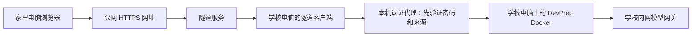

# 学校电脑运行、家里通过公网网址访问：研究报告

调研日期：2026-10-16。用户目标：学校电脑周末不关机，程序继续使用学校内网模型网关，家里只打开一个网址访问程序。本文针对这个目标，不要求家里电脑能直接连学校的 `192.168.*.*` 网关。

## 结论与推荐

**可以实现，且无需租云服务器、无需学校提供公网 IP。** 在学校电脑运行一个向外建立连接的隧道客户端，获得公网 HTTPS 网址。家里访问这个网址，隧道把网页和 API 请求送回学校电脑；Spring Boot 仍由学校电脑访问原来的内网模型网关。

当前配置的所选 provider 已确认是私有 IP 地址，模型调用由后端发出。无须把网关地址改成公网地址，也无须在家里另配网关或密钥。本轮只检查地址类别，没有复制或展示密钥。

优先建议 **Tailscale Funnel + 本机带密码的反向代理**，免费个人计划即可取得 `*.ts.net` HTTPS 入口，家里只需浏览器，不必安装 Tailscale。备选 **ngrok 免费开发域名 + 同一认证代理**。有现成域名则可选 **Cloudflare 命名 Tunnel + Access**。

这些方案把程序继续放在学校电脑，仅提供外网入口，不是将应用迁移到免费云主机。免费云主机即使能跑 Java，也不能自动进入学校局域网；仍要额外建立学校到云端的链路，对当前目标没有更省事。

公网入口只指向 DevPrep 的网页与 API，不对外发布内网网关、数据库或整个学校网络。

## 免费方案比较

价格和额度以本次官网资料为依据，服务商可能调整，实际以账户后台为准。未从家里网络实测连通性。

| 方案 | 家里怎么访问 | 费用与前提 | 对本项目的影响 | 建议 |
| --- | --- | --- | --- | --- |
| Tailscale Funnel | 直接打开设备对应的 `https://设备名.网络名.ts.net` | Personal 当前 $0、最多6个用户，个人用户设备不设数量上限；Funnel 对所有计划开放，无需自购域名 | 要安装并登录学校端 Tailscale，开启 MagicDNS/HTTPS/Funnel；有不可自行调整的带宽限制。公网入口本身不是私人访问控制，需另加密码 | **无域名、个人周末使用的首选候选**。先实测学校出站、家庭访问及聊天流式响应 |
| ngrok Free | 直接打开账户分配的开发 HTTPS 域名 | 无需自购域名；文档列出1GB/月外发流量、20,000 HTTP请求/月、最多3个在线端点 | 首次网页有官方提示页，点击继续后缓存7天；免费端点没有运行时限。HTTP文档的连接空闲超时为5分钟，须验证长耗时AI操作 | **易上手备选**。平时文字练习可尝试，1GB不能当无限额度；不建议通过它下载559MB迁移包 |
| Cloudflare 命名 Tunnel + Access | 自己域名下的 `https://study.你的域名`，邮箱验证码或身份登录 | Tunnel/Access可用免费层；Access官网列50用户免费上限。常规命名公网应用需要自己已持有并接入的域名，买域名不是免费 | 相比临时隧道更适合固定入口；普通HTTP长等待仍受边缘读取超时影响，官网本次显示125秒，慢速简历/面试生成要实测 | **已有域名时适合长期入口**。确保流式接口不缓冲，慢请求可能需异步任务适配 |
| Cloudflare Quick Tunnel | 随机 `*.trycloudflare.com` 地址 | 不需要账户或域名 | 官网明确不支持 SSE；地址随新进程变化、无在线保证、最多200个并行处理中请求。本项目学习聊天使用SSE | **不作为完整功能的推荐**。不能只因首页能开就认定聊天可用 |
| FRP / rathole 自建 | 自己服务器IP或域名 | 软件免费，通常仍需一台可达的公网服务器或可用的第三方中继 | 自己维护认证、HTTPS、中继和更新；“软件开源”不等于“无需服务器费用” | 有现成服务器再考虑，无服务器时不优先 |
| 远程桌面 / 私有组网 | 连接学校桌面，或家里也装客户端 | 可免费 | 能用，但不等同用户所要的“家里直接打开公网网址” | 作为备用排障方式，不作为主方案 |

Tailscale Funnel 官方限制：使用自己 tailnet 的 `*.ts.net` 名称，对外端口只能是443、8443或10000、要求TLS；学校程序自己的端口仍可保持8765。免费不代表无限带宽或保证国内网络速度，公开资料没有给出适合本机的固定实测速率。

ngrok免费页面和价格页的额度表述略有差别：限制文档按月列额度，价格页另列一次性开发使用额度。开通时以后台当前免费额度和计费设置核对，不把旧教程中的“无限流量免费隧道”当承诺。

## 本项目确实需要解决的兼容问题

不是把隧道指向8765就全部完成。本轮已在本机发送模拟公网 Host/Origin 请求：本地正常健康接口为200，模拟公网域名时返回 **403**。

原因在 `WebConfig`：当前只接受 `localhost/127.0.0.1` 一类本机 Host 和 Origin，适合本机单人运行。这个检查不能为了公网访问直接删除。同时当前应用没有公网用户登录层；拿到网址的人如果不先认证，就可能读取私人材料、修改配置或调用模型。因此应当增加统一入口认证，覆盖首页、静态文件、下载和全部API。

建议用一个**仅绑定本机的认证代理**（如 Caddy，监听127.0.0.1:8876）：

1. 隧道只转发到认证代理，不直接指向应用。
2. 代理要求独立用户名与强密码，配置只保存密码哈希；外侧连接使用隧道提供的HTTPS。或由Cloudflare Access先完成身份认证。
3. 代理先检查请求 Origin：只接受实际公网入口，拒绝其他网站的跨站写请求。验证后再将上游Host/Origin规范为本机值，转发到127.0.0.1:8765。
4. 不信任用户自行传入的转发头，不把“改成localhost”当身份认证，也不全局放宽CORS。应用原有本机检查继续保留。
5. 关闭响应缓冲，支持 `text/event-stream`。Caddy官方提供 `flush_interval` 配置，Tailscale源码使用Go标准反向代理；ngrok文档也有SSE处理能力。这些依据说明有实现路径，仍需登录实际账户后做全链路验证。

这样可以不改主体业务代码，通过部署层解决入口认证与来源适配。认证代理、隧道都应绑定或转发明确端口，不需要把8765改成对全校或公网监听。

Tailscale官方命令形态为 `tailscale funnel --bg http://127.0.0.1:8876`；这是**认证代理准备好之后**的接入示意，不是本轮已经执行的开通命令。`--bg`可保存后台提供服务的配置，仍要确认Windows端服务与无人值守模式能在重启后恢复。

## 模型和程序是否仍然能用

家里浏览器 → 学校 DevPrep → 学校内网网关，这是完整调用链。内网地址对家里不可达不影响该链路；前提是学校电脑自己仍有校园网络和网关权限，网关本身周末也在线。

现有模型全局串行、完成后默认等待10秒的逻辑继续使用，不增加并发通道。隧道不等于免费模型，只是免费或低成本地使用原来的机器；网关原有的用量、额度与授权规则不变。

AI聊天是SSE流式，简历、求职材料、模拟面试部分请求则可能等模型完成再返回JSON。要分别测：能打开首页、能练离线题、能读参考答案、能流式聊天、能等待完整生成、能下载Word。这些结果不能互相代替。比如Cloudflare命名隧道可以传流式数据，但一个长时间没有响应字节的JSON生成仍可能触发边缘超时。

## 学校电脑周末运行条件

本机当前接通电源的睡眠超时为0（不自动睡眠），Docker应用为 `restart: unless-stopped`。本轮没有改电源设置。

还需确认：电脑保持供电，网络不中断，校园认证不会周末失效；屏幕关闭或Windows锁屏可以，但进入睡眠、断电或被系统更新重启会中断服务。Docker Desktop通常依赖用户登录后启动，仅设置容器自动重启不足以保证无人登录时启动。隧道客户端、认证代理也要配置持续运行与重启恢复。

若学校网络限制外连隧道，或宿舍/家庭网络对相关域名不稳定，要换可访问的服务；不能仅凭学校端访问服务商官网正常就保证家里端也顺畅。现阶段没有实测家庭网，不承诺任何供应商必定可用。

## 实际推进步骤

建议顺序：

1. 在学校电脑准备本机认证代理，检查未认证访问全部被拒绝、已认证的网页与API正常。
2. 登录并开通Tailscale Personal，开启Funnel所需设置，取得对应HTTPS网址；如学校/家庭链路不合适，再使用ngrok免费域名。
3. 在家里的浏览器或手机蜂窝网络验证外网访问，包括离线练题、参考答案、一次短的GPT聊天和一次材料生成；模型验证只在用户决定正式启用后进行。
4. 确认启动恢复和省电设置，保存关闭入口的方法（例如Funnel reset/停止代理），再让电脑周末持续运行。

本轮完成调研和兼容性检查，**没有创建公网隧道、发布私人网址、安装远控软件或改变防火墙/来源限制**。实际开通需要用户的隧道服务账户和自己的入口密码；到那一步应由用户登录账户，密码不写入公共Git或报告。

## 小林 coding：本轮已经完成

确认网站为 [小林coding](https://xiaolincoding.com/)，公开面试题目录为 [Java及后端面试题汇总](https://xiaolincoding.com/interview/)。作者网站称来源于读者面经，覆盖大中厂常见题；这不是“大厂按某网站统一出题”的证据。

已串行读取23篇公开问答文章，提取 **1,653道中文题、131个知识分组**，合并并载入当前Docker应用。原有中文翻译与题目保留，合并后本地知识问答题库为 **11,663题、314个知识分组**（不计独立算法、模拟面经库）。每题保留官网章节URL、作者、文章校验值和抓取时间；没有调用任何外部模型。

导入及本地核验：36项内容解析测试通过；`/api/knowledge`可见131个新增分组，`/api/practice/next`可返回小林中文题，`/api/practice/reference`可返回中文参考答案。题库更新前已备份原题库与数据库。

这不是图片完整离线镜像，正文可离线练习，图片仍链接原站。Go和网络等实际提取数与网站目录显示的数字略有不同，按有效问答实数报告，不为凑数编造题。AI/Agent专题链接到另一个网站，本轮没有下载这些栏目。

文件位置：

- 本地独立题库：`.cache/content/xiaolin/xiaolin.learning.json`
- 公开文章快照：`.cache/content/xiaolin/html/`
- 来源审计：`.cache/content/xiaolin/xiaolin.audit.json`
- 合并后的在用题库：`.cache/content/local.learning.zh-CN.json`
- 作者公开图解仓库快照：`.cache/content/xiaolin/CS-Base-381b8461.zip`
- 可重复使用的导入脚本与说明：`scripts/content-import/xiaolin.py`、`docs/content-import/xiaolin.md`

原文保留作者版权，仅放用户本地，不推送公共仓库。详细使用方法见[小林本地题库说明](../content-import/xiaolin.md)。

## 核验来源

以下是本轮直接读取的官方资料，抓取证据保存在本机忽略目录；报告中的能力、限制与价格不引用第三方旧教程：

- [Tailscale 定价](https://tailscale.com/pricing)：Personal免费计划、用户与设备额度。
- [Tailscale Funnel](https://tailscale.com/kb/1223/funnel)：公网访问、所有计划可用、域名/端口/带宽限制。
- [Tailscale Funnel CLI](https://tailscale.com/kb/1311/tailscale-funnel)：后台模式、状态与重置命令。
- [Tailscale Serve源码](https://github.com/tailscale/tailscale/blob/main/ipn/ipnlocal/serve.go)：保留请求Host、标准反向代理实现；需处理本项目来源检查。
- [ngrok Free Plan Limits](https://ngrok.com/docs/pricing-limits/free-plan-limits)：开发域名、流量、请求、提示页、运行时限。
- [ngrok Pricing](https://ngrok.com/pricing)、[HTTP Endpoints](https://ngrok.com/docs/gateway/http.md)：额度及连接/HTTP超时。
- [Cloudflare Quick Tunnels](https://developers.cloudflare.com/cloudflare-one/networks/connectors/cloudflare-tunnel/do-more-with-tunnels/trycloudflare/)及[官方文档源码](https://github.com/cloudflare/cloudflare-docs/blob/production/src/content/docs/tunnel/get-started/quick-tunnels/index.mdx)：随机域名、SSE限制、在线保证。
- [Cloudflare Access](https://www.cloudflare.com/zero-trust/products/access/)：免费计划与50用户上限。
- [Cloudflare Tunnel](https://developers.cloudflare.com/cloudflare-one/networks/connectors/cloudflare-tunnel/)及[连接限制](https://developers.cloudflare.com/fundamentals/reference/connection-limits/)：出站隧道与HTTP读取超时。
- [Caddy Basic Auth](https://caddyserver.com/docs/caddyfile/directives/basic_auth)、[Reverse Proxy](https://caddyserver.com/docs/caddyfile/directives/reverse_proxy)：密码哈希、请求头和流式刷新。
- [小林coding公开面试题](https://xiaolincoding.com/interview/)、[作者CS-Base仓库](https://github.com/xiaolincoder/CS-Base)：题库来源、图解源文件及署名。
